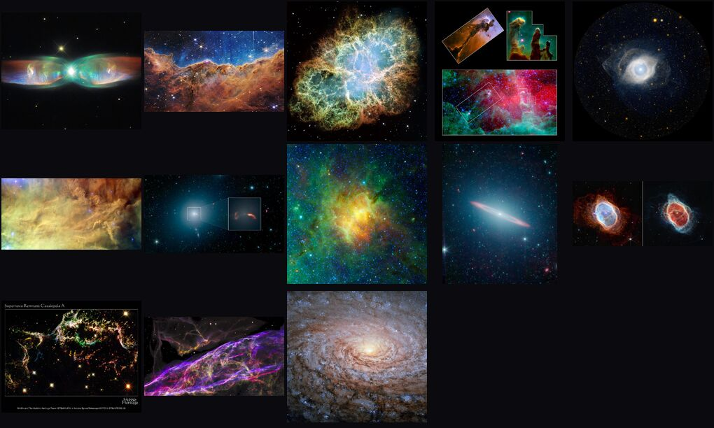
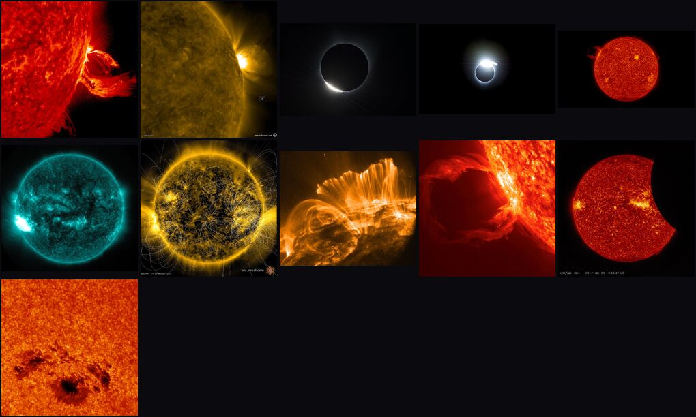
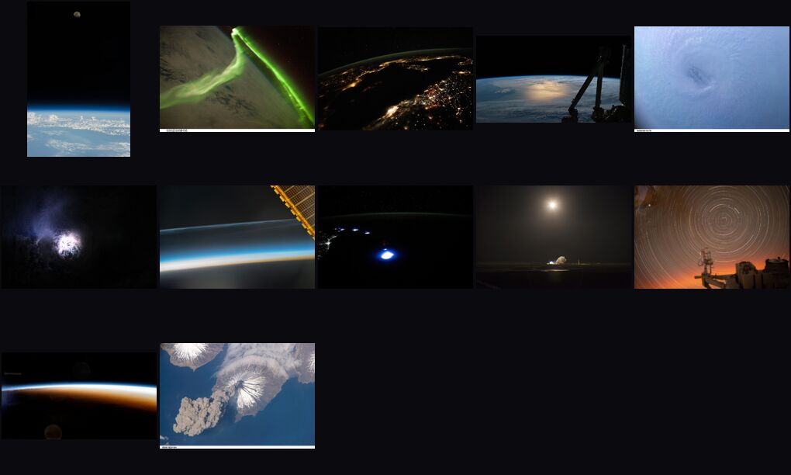

# VFX reference library

Real phenomena to steal structure from (public domain, NASA image library). Re-fetch or extend with `python3 fetch_refs.py [set]`; `manifest.json` holds the NASA id, title and the lesson for every image. Contact sheets: `sheet_<set>.jpg`.

How to use: pick 2–3 references, name what each gives (silhouette, layering, motion, colour temperature), then build that structure from particles and beams. Never copy the photo as a texture.

## Space: nebulae, galaxies, remnants (13)

| Image | Lesson for auras |
|---|---|
| [pillars](space/pillars.jpg) | layered dust with lit rims: dark mass + bright edge is the depth cue |
| [carina](space/carina.jpg) | gas wall with glowing ridge line; stars in front sell the scale |
| [crab](space/crab.jpg) | filament web over a soft glow: two frequencies of detail |
| [helix](space/helix.jpg) | eye shape: ring of knots pointing inward = radial streaks |
| [eagle](space/eagle.jpg) | backlit plume silhouettes |
| [m87_jet](space/m87_jet.jpg) | one narrow jet beats a cone: thin and bright |
| [whirlpool](space/whirlpool.jpg) | spiral arms = dust lanes inside the glow, not on top |
| [sombrero](space/sombrero.jpg) | edge-on disc with dark lane across a bright bulge |
| [supernova](space/supernova.jpg) | shredded shell, knots of hot colour |
| [butterfly](space/butterfly.jpg) | twin lobes from a pinched waist: bipolar burst |
| [lagoon](space/lagoon.jpg) | twisted dark ribbons through bright gas |
| [veil](space/veil.jpg) | thin filaments like hair: wisps for trails |
| [southern_ring](space/southern_ring.jpg) | concentric shells, orange outer vs blue inner: temperature as colour |

## Sun: plasma, flares, corona (11)

| Image | Lesson for auras |
|---|---|
| [prominence](sun/prominence.jpg) | plasma loops: arcs anchored at both ends |
| [coronal_loops](sun/coronal_loops.jpg) | many thin glowing strands in one arch bundle |
| [flare_x](sun/flare_x.jpg) | a flare blooms white then cools to orange |
| [cme](sun/cme.jpg) | expanding bubble with bright leading edge |
| [eclipse_corona](sun/eclipse_corona.jpg) | black disc with feathered rays: the perfect aura silhouette |
| [filament](sun/filament.jpg) | dark thread in front of bright plasma |
| [sunspot](sun/sunspot.jpg) | radial penumbra filaments |
| [sdo_304](sun/sdo_304.jpg) | fuzzy limb: soft halo past a hard edge |
| [diamond_ring](sun/diamond_ring.jpg) | one point of light breaking the rim = the impact frame |
| [plasma_rain](sun/plasma_rain.jpg) | material falling back along the loop |
| [helioseismic](sun/helioseismic.jpg) | field lines as ribbon paths |

## Atmosphere from orbit: aurora, lightning, limb glow (12)

| Image | Lesson for auras |
|---|---|
| [aurora_iss](atmosphere/aurora_iss.jpg) | curtains with sharp lower edge, faded top |
| [red_sprite](atmosphere/red_sprite.jpg) | jellyfish-like discharge: tendrils hanging down |
| [lightning_iss](atmosphere/lightning_iss.jpg) | cloud lit from inside: glow beneath a surface |
| [airglow](atmosphere/airglow.jpg) | thin layered band on the curve: rim light |
| [noctilucent](atmosphere/noctilucent.jpg) | rippled glowing filaments in the dark |
| [volcano_iss](atmosphere/volcano_iss.jpg) | plume with rolling heads |
| [hurricane_eye](atmosphere/hurricane_eye.jpg) | spiral bands around a clear eye: a vortex that reads |
| [city_lights](atmosphere/city_lights.jpg) | networks of points: sparse sparkle texture |
| [sunrise_limb](atmosphere/sunrise_limb.jpg) | thin bright arc, colour bands |
| [rocket_plume](atmosphere/rocket_plume.jpg) | core white, shock diamonds, smoke catching light |
| [star_trails](atmosphere/star_trails.jpg) | circular streaks = motion over time |
| [glint](atmosphere/glint.jpg) | specular hot spot over a dark surface |

## Cross-cutting rules these teach

- **Hot core, colour at the falloff.** The centre blows to white; saturated colour lives in the mid-halo (Orion, flares).
- **Dark structure in front of glow** gives depth with zero geometry (Pillars, Sombrero dust lane, solar filaments).
- **Two frequencies of detail:** soft glow + thin filaments (Crab, Veil). One alone reads cheap.
- **Radial structure reads as power:** rays converging on a source (eclipse corona, aurora corona, Helix knots).
- **Edge-on beats face-on** for discs (Sombrero, black-hole discs).
- **Temperature as colour:** hot inner blue/white, cool outer red/orange, or the reverse, but never random.
