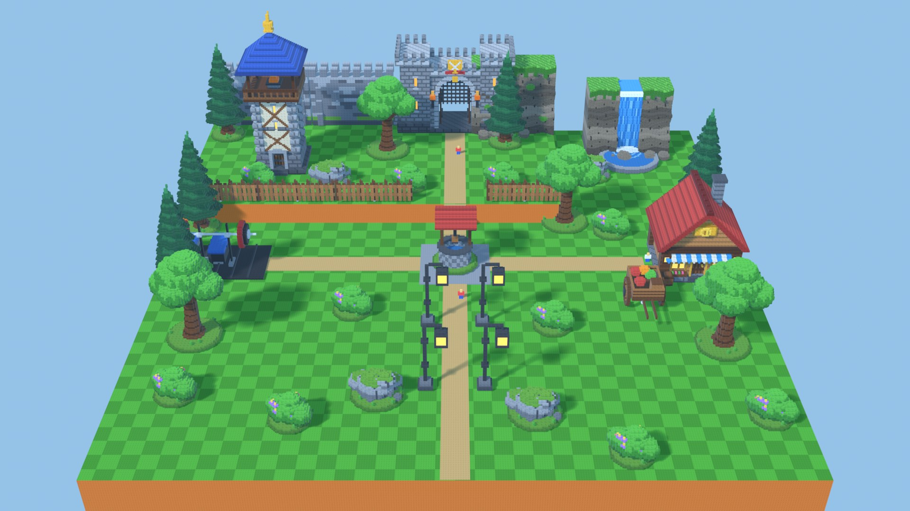
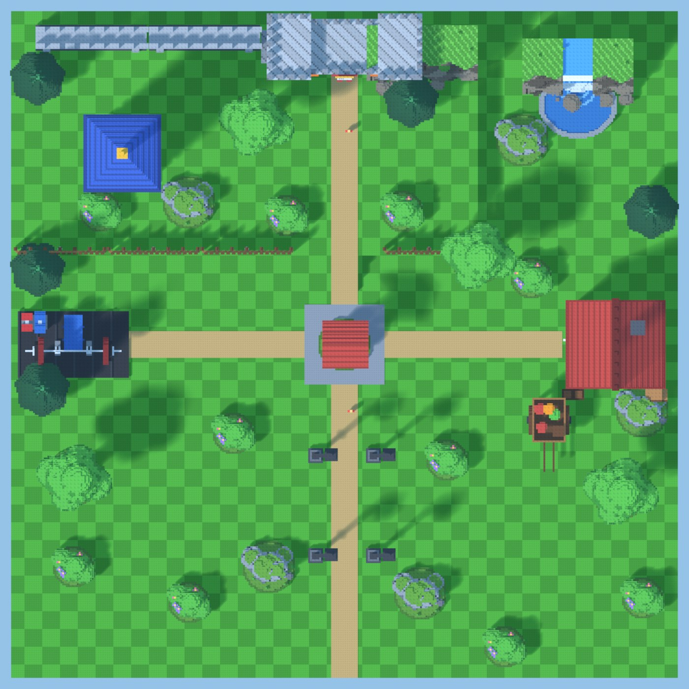
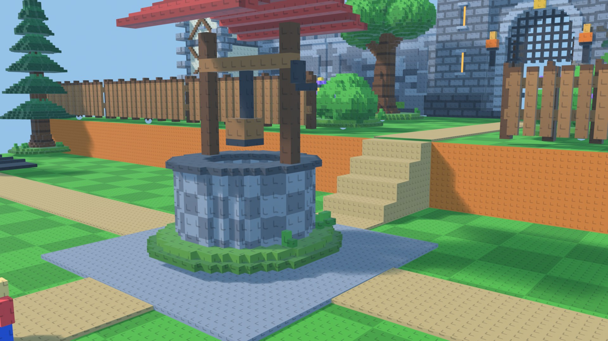

# Stud map guide

One readable stud area, built only from the [LihFolk Stud Voxel pack](../../.claude/skills/lihfolk-stud-voxel/SKILL.md) and laid out by the [world hierarchy](world-hierarchy.md). Download it, open it, copy the layout rules.

**Download:** [`examples/map-guide/StudMapGuide.glb`](../../examples/map-guide/StudMapGuide.glb) (7.6 MB, 111 meshes, 175k triangles, largest piece 16,016 triangles, so every piece is under Roblox's 20k cap).
**Rebuild or change it:** `blender -b --factory-startup --python examples/map-guide/build_map.py -- render plan close export` from the repo root (Blender 4.2+). Output goes to `examples/map-guide/out/`.

## 1. The layout

The area is 300 × 300 studs. The camera looks north, so everything tall sits on the north half.

| Where | What | Tier ([world hierarchy](world-hierarchy.md)) | Why it's there |
|---|---|---|---|
| South edge | spawn, the path starts | — | the player starts in the open, facing the goal |
| South half | low bushes and rocks only | 5 dressing | the foreground never hides the player |
| Centre | plaza with the well, lamps along the path | 2 interactable, 4 props | the first stop; every path meets here |
| East / west | shop, training yard, at the ends of the side paths | 2 interactables | each path ends at something to do |
| North | 12-stud terrace, fenced, reached by steps on the path line | 4 structure, 6 ground | height splits the area into "here" and "next" |
| North-west | the watchtower | 3 landmark (the only one) | the tallest silhouette, framing the play area from a corner |
| North edge | castle wall and gate, a cliff, a waterfall | 7 backdrop | closes the world; the gate is where the path leads |
| Side edges | oaks and pines | 5 dressing | a natural vignette, denser at the edges |
| On the path | three 5-stud stand-ins | 1 actors | scale reference, the brightest things on screen |

## 2. Rules with numbers

- **Grid:** everything sits on whole studs. The grass is an 8-stud checker in two greens.
- **Path:** 12 studs wide, straight from spawn to the plaza and on up to the gate. Side branches are 12 wide and end at an interactable.
- **Steps:** 3-stud rises, 4-stud treads, as wide as the path. Terrace height is 12 studs (4 steps).
- **Plaza:** 36 × 36 studs, a different colour from the path, so it reads as a place, not a road.
- **One landmark per area,** on a corner of the north half. A second tall thing (the gate) goes into the backdrop line, not the play area.
- **Foreground:** nothing taller than a bush in the south half. Our first draft put the gate and walls there, and they hid half the area.
- **Dressing:** trees on the side edges and behind; never on a path, the plaza or the steps.
- **Ground stays quieter than props.** The first grass we tried (`#5CC43A`) out-shone the trees; the shipped greens are `#4FAE35` and `#3E9429`. Dirt `#E07A2C`, path `#C9A66B`, plaza `#8E95A0`.

## 3. Studs on every face

- Every material is **colour × the stud texture** (`stud_mul.png`: the default Roblox square stud, 8 × 8 studs per tile, with the 2× overlay baked in).
- UVs are world-aligned: `(x, y) / 8` on tops, `(x, z) / 8` and `(y, z) / 8` on the sides, so studs run straight across neighbouring blocks and never stretch.
- That's a plain base colour plus one texture, so it survives the `.glb` export and the Roblox importer as-is.
- Two mistakes we made first: mapping the texture at one tile per stud (the studs shrank to sub-pixel and vanished), and typing sRGB hex values into Blender's linear colour fields (everything went pastel). The builder converts hex with `lin()`.

## 4. Import into Roblox

1. **3D Importer** → `StudMapGuide.glb`, unit = **Stud**. Every piece lands as a MeshPart.
2. Select all → **Anchored** on. Set the **Watchtower, CastleGate, Lamp and Shop glow pieces** to Neon if you want them to bloom.
3. **Collision:** the visual meshes should be `CanCollide = false` with `CollisionFidelity = Box`. Add plain parts for the walkable ground (one per slab: ground, terrace, each step) so floors are flat.
4. Group by the tiers above (`World/Areas/<area>/Ground | Landmarks | Interactables | Props | Foliage | Rocks`), the Explorer contract in the [world hierarchy playbook](world-hierarchy.md#3-the-explorer-tree-nothing-map-related-lives-anywhere-else).

## 5. Scale: read this before you build

The pack's props are large next to a 5-stud character: the well is 33 studs tall, an oak 48, the watchtower 92. That reads well from a high camera (the hero shot) but looms at street level (the close-up). For an avatar-scale game, scale the props to about **0.5–0.6** and keep the ground grid as it is. Doors must stay at least 8 studs tall and paths at least 6 wide (the pack's own rules).

## Self-check

- [ ] The path goes from spawn to the goal in one straight read; every branch ends at something.
- [ ] One landmark; everything tall is on the north half; the foreground is low.
- [ ] Squint: the players and interactables pop before the grass does.
- [ ] Studs are 1 × 1 everywhere, straight across blocks.
- [ ] Every mesh piece is under 20,000 triangles; floors have flat collision parts.
