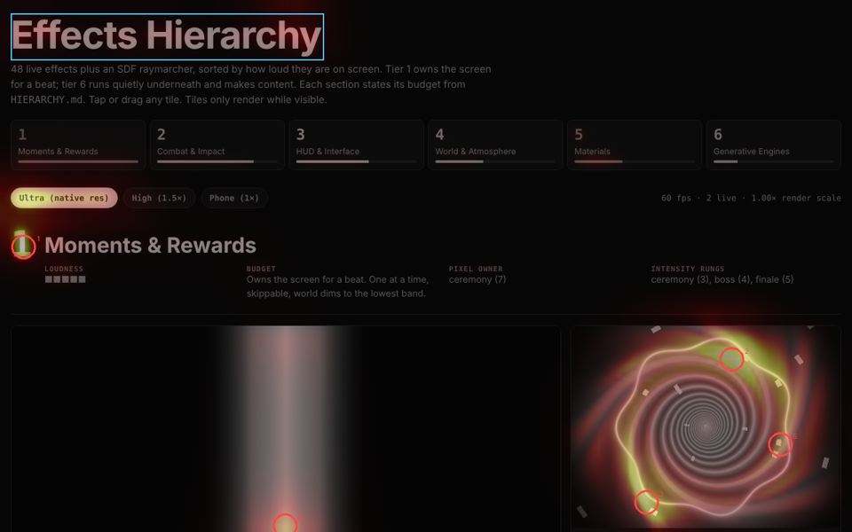

# Measuring hierarchy

Part V, Hierarchy science. This chapter turns chapters [80](80-attention-and-salience.md)–[84](84-grouping-density-and-choice.md) into checks a script, Claude or a playtester can run. The tool is [`tools/hierarchy`](../../tools/hierarchy/README.md); the in-game twin is `Perceptual.luau` in the [hierarchy-audit skill](../../.claude/skills/hierarchy-audit/SKILL.md).

## Takeaway

Every screen and effect gets four numbers before review: **first fixation** (does the eye land on the focus?), **focus lift** (does the focus hold more than its share of salience?), **squint value gap** (does the hierarchy survive without colour and detail?) and **flash count** (is it safe?). Text adds **APCA Lc**. Colour codes add a **deutan re-check**. People confirm the result, not the other way round.

## 1. The checks

| Check | Command | Pass (house thresholds) | Built on |
|---|---|---|---|
| Predicted scanpath | `audit shot.png --focus x,y,w,h` | fixation 1 inside the focus | Itti 1998 WTA + IOR; Hou & Zhang 2007 |
| Focus lift | same | lift ≥ 1.5 (FAIL < 1.0) | salience share ÷ area share |
| Loudest competitor | same | < 90% of the focus peak | HIERARCHY §13 one loud element |
| Squint value gap | same | ≥ 0.08 OKLab L between the focus and a ring around it | figure-ground gate, §11 |
| Colour-blind re-check | same | fixation 1 still in the focus under deutan and protan | Machado 2009 |
| Clutter | same | combat ≤ about 2× the calm frame's edge density | Rosenholtz 2007 |
| Text contrast | `apca '#text' '#bg'` | abs(Lc) ≥ 75 play-critical, ≥ 60 labels, ≥ 30 disabled | APCA 0.0.98G |
| Flash safety | `flash effect.gif` | ≤ 3 flashes/s beyond 2.78% of the screen | WCAG 2.3.1 |
| CVD preview | `cvd shot.png --type deutan --out x.png` | look at it | Machado 2009 |

`audit` writes `<out>.png`: the screenshot in grey with a heat overlay, the focus box in blue, and the predicted fixations numbered (green inside the focus, red outside). It also writes `<out>.json` with every number, and exits 1 on FAIL so it can gate CI.

## 2. How the salience model works (and how it fails)

1. Convert to OKLab.
2. **Spectral residual** on L at 64 px wide: log-amplitude minus its 3 × 3 average, inverse FFT, squared, blurred.
3. **Centre-surround** on L, a and b at 160 px wide: |blur σ(1,2) − blur σ(4,8,16)| at four scale pairs. Each channel is weighted down by how much of it is "loud", which is Itti's few-peaks normalisation.
4. Average the two, normalise, **square** (promotes peaks over halos), and optionally blend a central Gaussian (`--centre-bias 0.3` approximates Tatler's free-viewing bias).
5. **Scanpath:** take the maximum, suppress a Gaussian disc of radius 8% of the diagonal (IOR), repeat.

The test suite (`tools/hierarchy/test_hierarchy.py`) proves these behaviours on synthetic scenes: an odd red patch wins; a wrong focus fails; one yellow item beats a texture of 40 blue dots; an isoluminant red-on-green cue loses lift under the deutan simulation; IOR moves the scanpath to a new place; APCA matches its reference values (106.04, −107.88, 63.06, −68.54); a 7.5 Hz full-screen flash fails while a 1 Hz flash and a 2%-area flash pass.

**Known failure modes:**
- **Meaning isn't modelled.** Big headline text, faces, numbers the player wants and the next goal pull the eye top-down. On our effects gallery, the model ranks the bright pink section number first and the large white title only weakly. People probably read the title first. Treat a FAIL on a text-heavy screen as "check with a person", not "broken".
- **One frame of motion.** A screenshot has no onsets or motion, which are the strongest cues ([ch. 80 §3](80-attention-and-salience.md#3-what-captures-attention-involuntarily-onsets-and-looming)). For animated cues, audit the frame where the cue peaks, and check timing against [chapter 82](82-time-motion-and-cue-timing.md).
- **Thresholds are ours.** 1.5 lift, 0.08 ΔL and 90% competitor are starting values, picked so our known-good synthetic scenes pass and known-bad ones fail. Tune them against playtests (§5) and record changes here.

## 2b. Worked example: the effects gallery

`audit gallery.png --focus 16,20,470,70` (the page title as the intended focus) → **FAIL**. Lift is 2.27 and the squint gap 0.163, both fine. But fixation 1 lands on the hot-pink "1" section number, which reaches **271%** of the title's peak salience, and it stays there under deutan and protan simulation. A saturated warm hue on near-black beats large white text bottom-up. Two readings, both legitimate:
- **Accept it.** People read the title first because it's text at the top (top-down). The section number is a wayfinding cue, and being loud suits it.
- **Fix it.** If the title must win on salience alone, drop the numbers' chroma (OKLCH C 0.20 → 0.12) or make them outline-only, so the competitor falls below 90%.

That's the auditor's job: it doesn't decide, it makes the trade visible with a number.

## 3. Where it runs

- **Every look-dev pass** ([look-dev loop](../playbooks/look-dev-loop.md)): capture, then `audit` with the focus the pass intended, then paste the overlay into the pass notes.
- **Effects:** `flash` on every GIF in `media/gifs` runs in `tools/check_all.sh`, so a new unsafe capture fails the kit's checks.
- **UI from Figma:** export the frame, then `audit` with the CTA's rect as the focus. Rects come from the layout JSON ([Figma playbook](../playbooks/figma-to-roblox-ui.md)).
- **In game:** `Perceptual.luau` checks theme pairs (`apcaLc`, `wcagRatio`, `oklab`, `deltaE`, `simulateCvd`) at startup in Studio and warns on any pair below its Lc floor. It's cheap enough to run on every theme or rarity palette change.
- **Reviewers:** the [`visual-hierarchy` agent](../../.claude/agents/visual-hierarchy.md) reads the overlay and JSON and reports against HIERARCHY.md.

## 4. Other quick tests that need no tool

| Test | How | What it catches |
|---|---|---|
| Squint | blur your eyes or the image (the auditor's squint step) | value hierarchy; what survives at a glance |
| Grey | desaturate | hue-only codes |
| Thumbnail | view at 10% size | silhouette and focal point |
| Five-second test | show the screen for 5 s, then ask "what was it for, what would you press?" | the real top-down hierarchy |
| Flip | mirror the image | habituation: you stop seeing your own layout |

## 5. Validating with people

The model is a proxy. Calibrate it a few times per project:

1. **First-click test.** Show a screen and ask the player to tap what they'd do first. Log the position. Ten players are enough to see whether clicks agree with fixation 1.
2. **Five-second recall.** As above. If fewer than 7 of 10 name the focus element, the hierarchy fails whatever the auditor says.
3. **Webcam gaze (optional).** Browser-based webcam eye tracking is coarse (about 100+ px error), but enough to compare the first fixation region against the model. [UNVERIFIED accuracy for our setup; test before relying on it.]
4. **Record the disagreements** in this chapter. Each one is either a threshold to tune or a top-down effect to design around.

## 6. Gaps

- No validation against real players yet (§5 is the plan).
- The flash checker approximates WCAG's per-area rule by counting, per block, flashes inside a sliding 1 s window. It doesn't search for the worst 10° rectangle; it uses the screen-wide fraction instead, which is stricter when flashes are spread out and fine for full-frame effects. A professional analyser (for example a PEAT-style tool) should sign off any effect that comes close.
