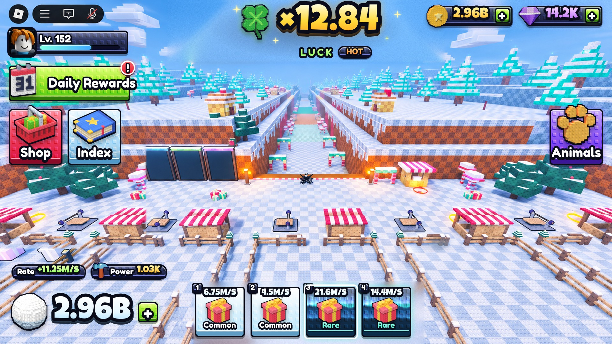
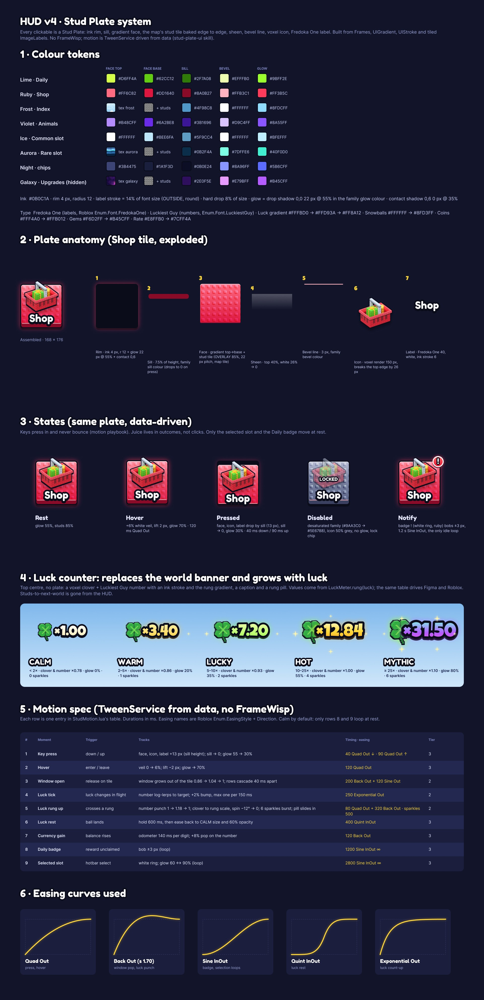

# HUD v4 · Stud Plate

The winter thrower's HUD, re-skinned in the Stud Plate style and mocked over a real capture of the corridor of worlds. Figma: page **HUD v4 · Stud Plate** in the game's design file (frames *Mockup · Corridor · Desktop 1920×1080*, *Spec · Stud Plate HUD v4*, *Before · original capture*). Procedure and code: the [stud-plate-ui skill](../../../.claude/skills/stud-plate-ui/SKILL.md).

## What changed from the capture

| Area | Before | Now |
|---|---|---|
| Top centre | "Frozen Lake" banner + "Next World 790 studs" bar | Luck meter: voxel clover + Luckiest Guy number, rung gradient and a rung pill (CALM → MYTHIC); it grows with luck like the throw overlay. No stud counter. |
| Left | 2×2 grid: Shop, Upgrades, Index, Animals | Daily Rewards (wide), then **Shop** and **Index** as square tiles |
| Right | nothing | **Animals** square tile (violet, so the orange paw pops). **Upgrades** is built but hidden: it isn't in the release. |
| Plates | flat colour tiles | Stud Plates: ink rim, sill, gradient or algorithm face, **the map's stud tile baked edge to edge**, sheen, bevel line |
| Icons | mixed 2D clip art | stud-voxel renders (basket, book, paw, calendar, clover, present, snowball, coin, gem) |
| Present slots | blue cards | Ice plates (Common) and aurora plates (Rare), with the selected slot ringed |

## Spec board

Tokens, exploded plate anatomy, states (rest, hover, pressed, disabled, notify), the luck ladder, the motion table and the easing curves. The motion table is `StudMotion.MOTION`; the luck ladder is `LuckMeter.RUNGS`.

## Files

| File | What |
|---|---|
| `backdrop_original.jpg` / `backdrop_clean.jpg` | the capture, and the capture with the old HUD painted out ([clean_plate.py](../../../tools/lookdev/clean_plate.py): left side mirror-filled from the right, the rest inpainted) |
| `fills/fill_*.png` | algorithm faces: galaxy, aurora, frost, ember ([stud_fills.py](../../../tools/lookdev/stud_fills.py)) |
| `fills/studs_ui_overlay.png` | the map stud tile with contrast ×2.1, for Figma OVERLAY fills at UI scale |
| `roblox/studs_light.png`, `roblox/studs_dark.png`, `roblox/glow_9slice.png` | Roblox stand-ins for the overlay and the glow ([stud_overlay_split.py](../../../tools/lookdev/stud_overlay_split.py)); upload these and pass their ids to `StudPlate.build` |
| `icons/icon_*.png` | voxel icon renders, 512 px, ink outline ([voxel_icons.py](../../../tools/lookdev/voxel_icons.py), needs `pip install bpy`) |

## Not done yet

- No Studio play test: nothing here is wired into the game, and the Roblox asset ids still need uploading.
- Phone layout (844×390) is specified by `Spec.scaleFor` but has no mockup frame yet.
- The capture's own baked UI (Roblox top bar) is kept; the painted-out areas under the present slots are soft but covered by the new HUD.
