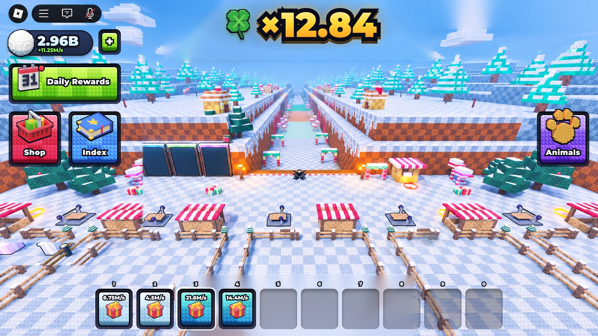
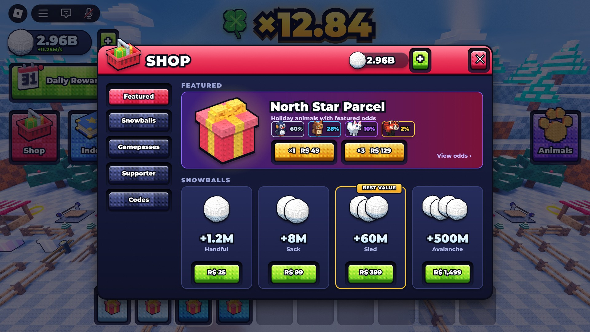
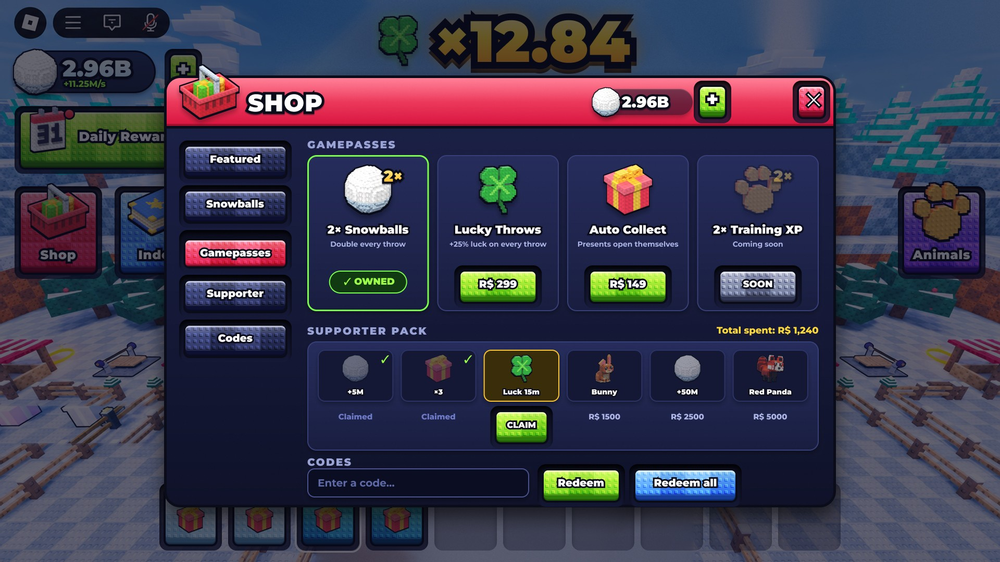
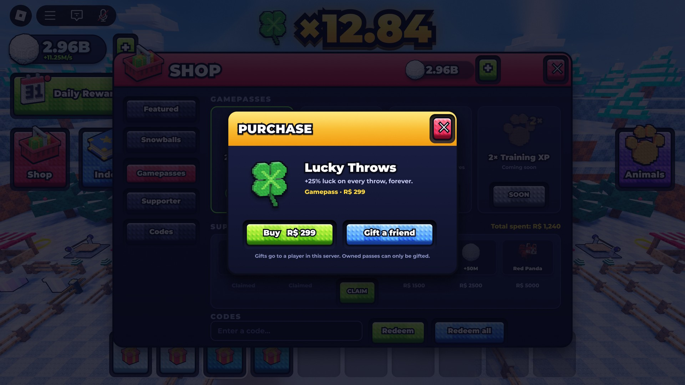
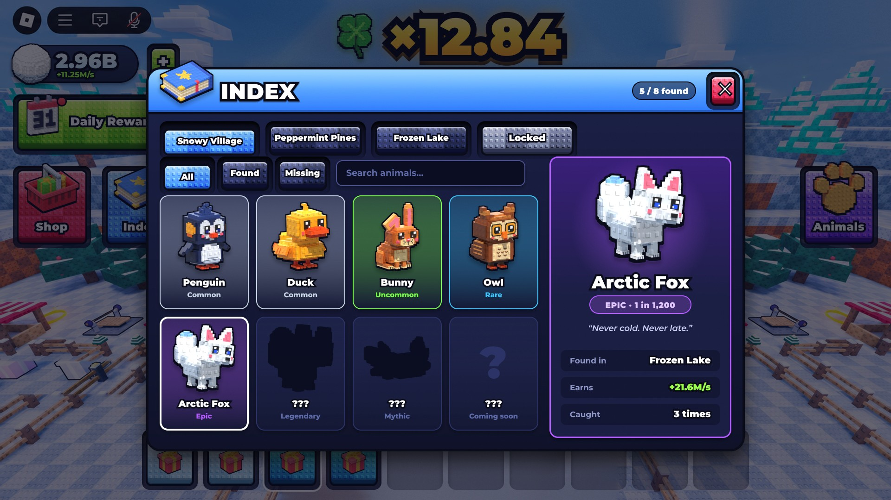
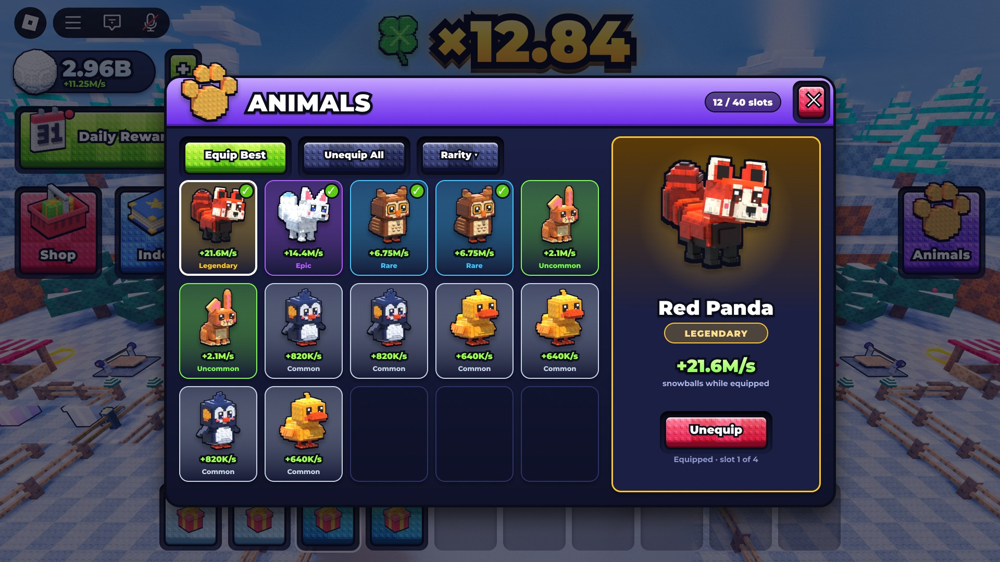
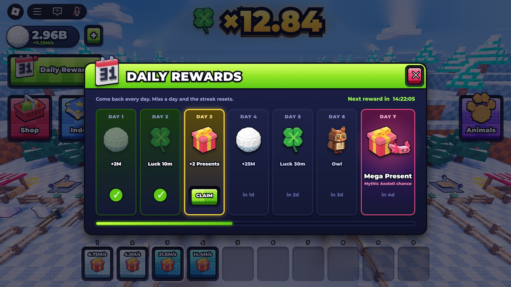
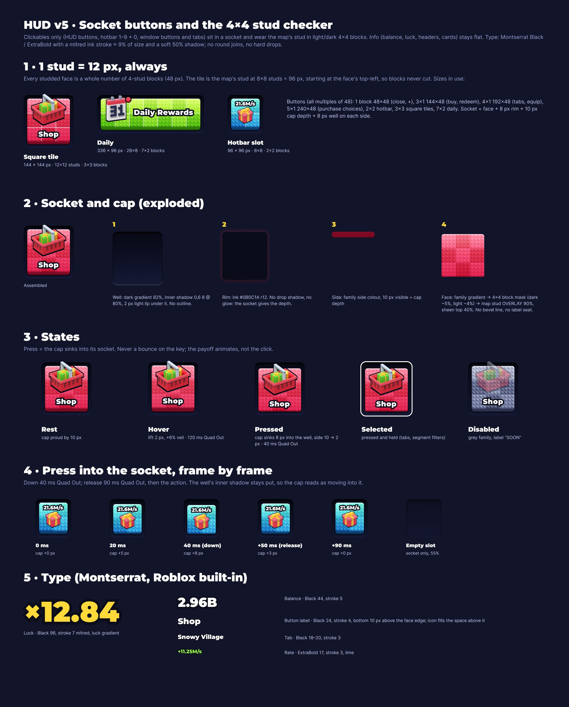

# HUD v5 · Socket

The winter thrower's HUD and all its windows. Clean and readable (Noob-Incremental-style restraint, not its look), with depth: every clickable is a **cap sitting in a socket** that sinks in when pressed, and wears the map's stud in **light/dark 4×4 blocks at exactly 12 px per stud**. Figma: page **HUD v5 · Socket** in the game's design file. Code: [stud-plate-ui skill](../../../.claude/skills/stud-plate-ui/SKILL.md) (`SocketSpec`, `StudSocket`).

## What changed from v4

- **Removed:** level chip, LUCK caption and HOT pill, coins and gems, the separate Power chip. The rate sits under the balance.
- **Type:** Montserrat Black / ExtraBold (Roblox built-in) with a mitred ink stroke ≈ 9% of size and a soft shadow. No round joins, no hard drops.
- **Studs:** only on clickables (HUD buttons, hotbar 1–9 + 0, window buttons, tabs and filters). Balance, luck, headers and cards are flat.
- **Hotbar:** ten sockets, keys 1–9 and 0; empty slots are bare sockets at 55%.
- **Daily badge:** a dot on the calendar instead of a floating "!".

## Windows

Built on the IMI 2 shop flow (a balance with + that jumps to the packs, sections, supporter tiers, codes, purchase options with Gift), in our template.

| | |
|---|---|
|  |  |
| **Shop · Featured**: featured parcel with odds, buy ×1 / ×3, snowball packs with a best-value tag | **Shop · Gamepasses**: owned / buy / coming soon, supporter tier track (claimed, claim, locked), codes with Redeem and Redeem all |
|  |  |
| **Purchase Options**: buy for me or gift a friend | **Index**: world tabs (locked world greyed), All/Found/Missing, search, rarity cells, silhouettes for missing animals, detail panel |
|  |  |
| **Animals**: Equip Best, Unequip All, sort, 12/40 slots, equipped ticks, detail with Unequip | **Daily Rewards**: 7-day track (claimed, today's CLAIM, locked), day-7 Mega Present, streak bar |

## Spec

1:1 stud grid and allowed face sizes, socket and cap exploded, states (rest, hover, pressed, selected, disabled), the press into the socket frame by frame, and the type ramp.

## Files

| File | What |
|---|---|
| `tex/studs_checker_overlay.png` | the map stud tile with light/dark 4×4 blocks, for Figma (TILE, OVERLAY, 96 px) |
| `tex/studs_checker_blocks.png` | the 4×4 on/off blocks alone; visible on any face colour, white included |
| `tex/studs_checker_light.png`, `tex/studs_checker_dark.png` | Roblox stand-ins for the overlay (no overlay blend in Roblox) |
| `animals/animal_*.png` | penguin, duck, arctic fox, red panda, owl, axolotl, bunny: the kit's stud-voxel critters rendered as icons ([critter_icon.py](../../../tools/lookdev/critter_icon.py)) |

Bake the checker with [stud_checker.py](../../../tools/lookdev/stud_checker.py). Icons from v4 live in [../hud-v4/icons](../hud-v4/icons).

## QA pass (latest)

- No baked drop shadows or glows behind any button, icon or label; the cap sinking into its socket is the only depth cue.

- Labels on the face, clear of the 3D side; no backing shadows; icons bigger and fitted above the label.
- Removed the bevel line on every face and the light outline on every socket; hotbar key numbers moved above the sockets.
- Checker softened (dark blocks ~5%, light ~4%) so it mixes with the face colour.
- Shop: header buttons centred in the header, CLAIM no longer overlaps its tier card, odds row clear of the buy buttons. Purchase header deepened so its close button fits. Index tab and filter rows aligned. Animals hero and Daily day-7 icons fit their cards.
- Hierarchy audit on the HUD: the luck number is the first and second predicted fixation, lift 1.52 (target 1.5); the strongest competitor is the Roblox top bar baked into the capture (78%). Still a warning: the squint value gap is low (bright UI on bright snow) because there are no backing plates.

## Not done yet

- Nothing is in Studio: the textures and icons need uploading, and `StudSocket` hasn't run in a live game.
- Phone landscape (844×390) has no mockup frame; `Spec.scaleFor` covers the scaling.
- The Index and Animals data are placeholders (names, rarities and rates are design values, not the game's tables).
